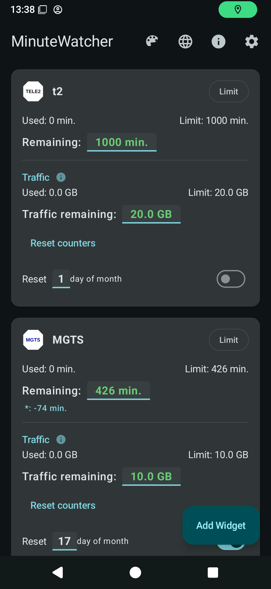
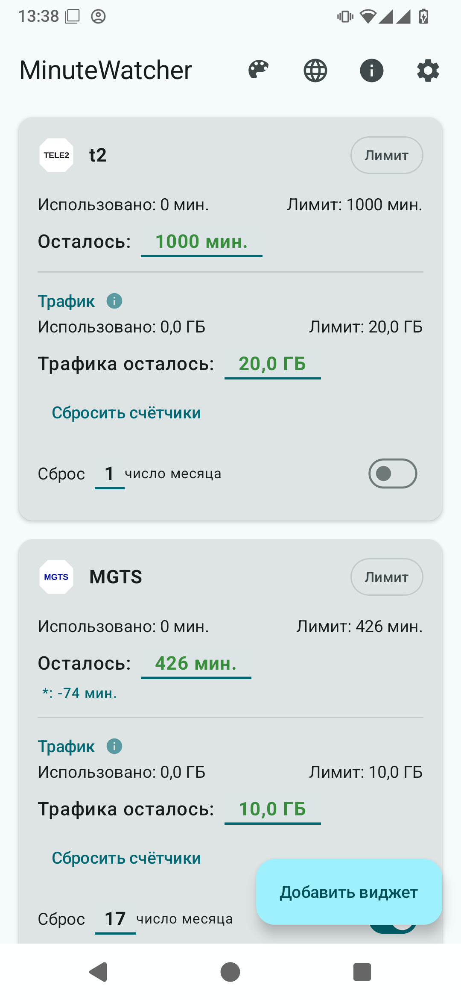
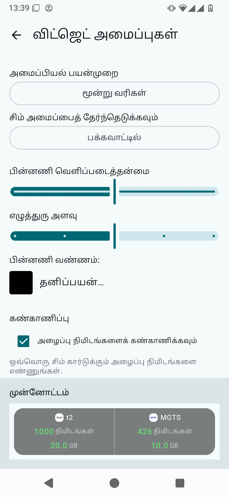
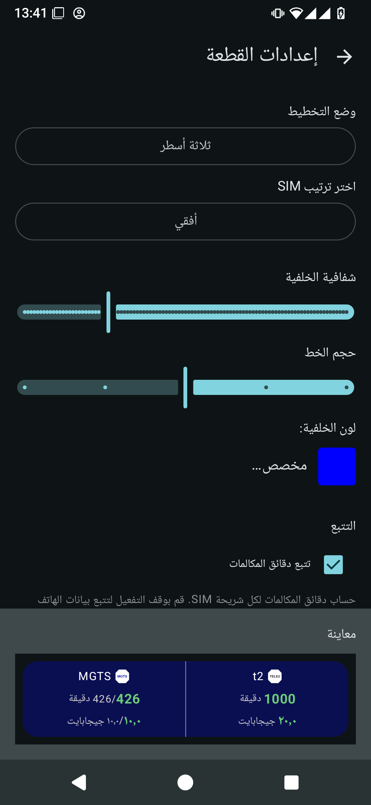
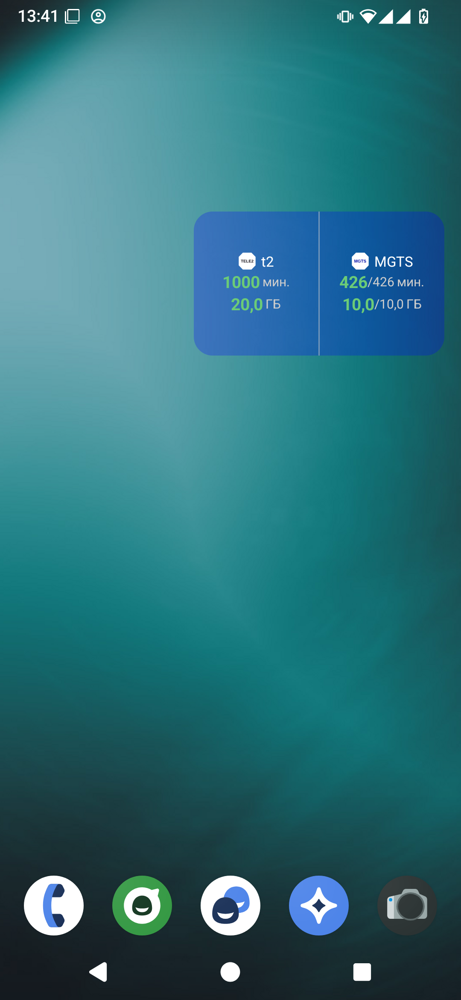
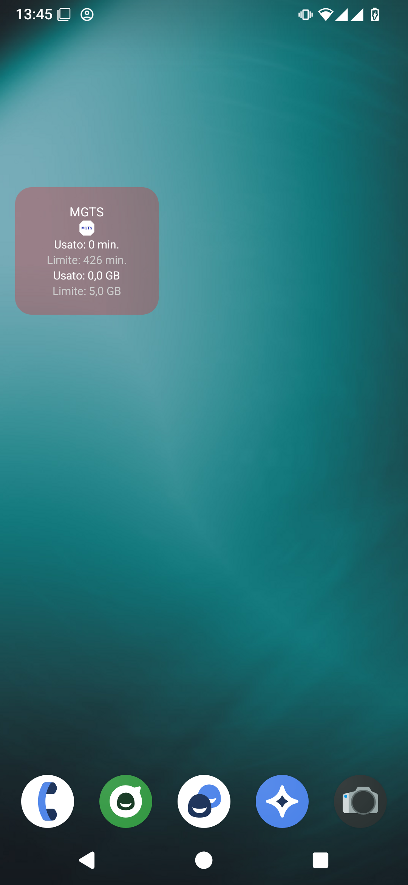

# MinuteWatcher

MinuteWatcher is an Android application designed to track your mobile carrier's minutes and data usage. It provides a clean UI, highly customizable home screen widgets, and deep integration with Android system features like AppSearch, Quick Settings Tiles, and Dynamic Shortcuts.

## Screenshots

  
  
  

  
  
  

## Key Features

- **Multi-SIM Support**: Architecture supports up to 10 slots (used in benchmark mode). Real-world devices with up to 3 SIMs are supported with independent limits and optimized widget layouts.
- **Customizable Widgets**: Multiple layout modes (including high-detail "Six Lines") with adjustable transparency, colors, and font sizes.
- **Smart Tracking**: Automatically tracks voice calls and mobile data usage using system APIs.
- **Always-on Display Summary**: optional persistent silent notification with remaining minutes and traffic; visible on the lock screen and on the Always-on Display of devices that show notifications there.
- **Manual Adjustments**: Easily correct usage values if they drift from your carrier's actual data.
- **Privacy First**: All data is stored locally. No third-party tracking or cloud uploads.
- **Multi-language Support**: Supports 28 languages (configured in `locales_config.xml`), including RTL (Arabic, Urdu,
  Persian) and CJK (Japanese, Chinese, Korean). The original (native) UI language is Russian; translations into other
  languages were machine-generated and may contain minor phrasing imperfections. If you notice an error or unnatural phrasing in
  your language, please contact the developer by email (available in the About dialog within the app).

## Technical Limitations

### Traffic Tracking
Android provides mobile data usage as an aggregate value for the entire device rather than per-SIM. MinuteWatcher attributes all detected mobile traffic to the SIM card currently selected as the **"Default Data SIM"** in your system settings.
- Switching the default data SIM triggers an internal baseline reset to ensure traffic is correctly attributed to the new active SIM from that moment onward.
- Data consumed over Wi-Fi is ignored.

### Call Tracking
Call duration is tracked using real-time system state changes.
- The app does **not** read your call log history.
- Tracking begins when a call enters the "Off-hook" state and ends when the device returns to "Idle".
- **Dual-SIM Attribution**: If an "end call" event lacks SIM information (subId = -1), MinuteWatcher attributes it to
  the only active session. If all calls are ended simultaneously (global IDLE state), all tracked sessions are closed
  automatically. If multiple sessions remain active and cannot be distinguished, an error banner is displayed instead of
  guessing. This limitation is mostly resolved on Android 12+ where per-SIM call states are available.
- **Rounding Logic**: Call duration is rounded **up** to the nearest minute (e.g., a 1-second call adds 1 minute to usage, a 61-second call adds 2 minutes). This aligns with common mobile carrier billing policies.

### AppSearch Integration

Semantic indexing of usage data uses `PlatformStorage` on Android 12+ (API 31+) to participate in system search, and
bundled `LocalStorage` on Android 8.0–11 (API 26–30) as a private app index. Indexing is automatically disabled on
devices without the AppSearch system service or where AppSearch is unsupported.
- An error banner is **not** displayed for `NOT_SUPPORTED` errors to ensure a clean UX on these devices.
- For other recoverable issues (like database schema drift), the app attempts automatic recovery with limited retry attempts.

### Always-on Display
Android does not provide a public API to render custom application UI on a phone's ambient display (Always-on Display); documented ambient mode APIs exist only for Wear OS.

- MinuteWatcher implements this feature using a documented ongoing silent notification with `IMPORTANCE_LOW`.
- The visibility and layout of the summary on the Always-on Display depend on system settings. This behavior is controlled by the system.
- MinuteWatcher does not use undocumented APIs or private system settings (`Settings.Secure`).
- The summary displays lines only for SIM packages with configured limits. The feature is controlled via a toggle in the Notification Settings section.
- On Android 14+, the system allows users to dismiss ongoing notifications not tied to a foreground service (including
  via "Clear All"). When enabled, MinuteWatcher automatically restores the summary within the periodic self-check
  interval (~15 minutes) while the app process is alive.

## Permissions

To provide accurate tracking, MinuteWatcher requires the following permissions:
- **`READ_PHONE_STATE`**: Used to identify SIM cards (via Subscription ID) and detect active call states.
- **`PACKAGE_USAGE_STATS`** (Usage Access): Required to query the system for mobile data consumption.
- **`POST_NOTIFICATIONS`**: Used to send low-balance alerts for minutes and traffic, as well as an optional persistent summary notification for the lock screen and Always-on Display.
- **`RECEIVE_BOOT_COMPLETED`**: Allows the app to resume monitoring services automatically after a device reboot.

## Privacy & Security

MinuteWatcher is built with a "Local First" philosophy:
- **Zero Server Communication**: Your usage data, limits, and settings never leave your device.
- **No Analytics**: We do not use Firebase, Google Analytics, or any other tracking SDKs.
- **No Identity Storage**: SIM cards are identified by stable internal IDs; personal phone numbers or contact names are never accessed.
- **Backup**: Cloud backup is disabled for application data (DataStore and SharedPreferences) to protect your privacy. On Android 12 (API 31) and higher, only explicit device-to-device transfer is permitted. On older versions (API 26–30), application data is excluded from Auto Backup.
- **Privacy Policy**: See [PRIVACY_POLICY.md](https://raw.githubusercontent.com/djbigmuh/MinuteWatcher/main/PRIVACY_POLICY.md) for details.

## Technical Architecture

The app follows modern Android development best practices:
- **Language**: Kotlin
- **UI**: Jetpack Compose
- **DI**: Hilt
- **Background Work**: WorkManager
- **Data Storage**: DataStore (for usage data and UI settings).
- **Static Analysis**: Detekt and Ktlint enforced locally via `VERIFY.bat` (Windows) or `verify.ps1` (PowerShell); GitHub CI is not currently used.

### Non-Stable Dependencies
The project uses a few non-stable (Beta/Alpha) versions of critical libraries to access essential fixes and modern features:

- **Detekt (Alpha)**: Static analysis; the 2.x line is used ahead of its stable release for rule and Gradle
  compatibility.
- **AppFunctions (Beta)**: `androidx.appfunctions` is required for the AppFunctionServiceEntryPoint
  architecture used by on-device assistant integration; no stable release is available yet.

## Development Requirements

- **JDK**: JDK 21 (Temurin 21 recommended). Automatically provisioned via Gradle Toolchains and the Foojay Resolver
  convention plugin.
- **Gradle**: Configured via Gradle Wrapper or local environment for cross-platform compatibility.

## Distribution

MinuteWatcher is not published yet; distribution channels are in preparation:

- **Google Play**: store listing is being prepared; store metadata is maintained via `fastlane/`.
- **F-Droid**, **GitHub Releases**: planned.

For detailed release procedures, store metadata management, and build specifications, see [docs/release.md](docs/release.md).

## License

This project is licensed under the MIT License — see the [LICENSE](LICENSE) file for details.

Operator icons are trademarks of their respective owners, used for operator identification; list of sources and licenses
is available in [docs/operator_icons.md](docs/operator_icons.md).
